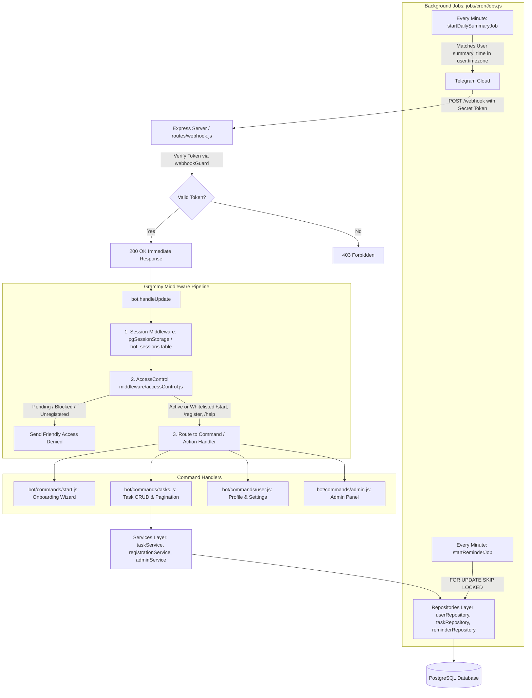

# AGENTS.md — AI Agent Guide to Telegram Task Manager Bot

This document serves as the primary system manual and coding specification for AI assistants, agents, and automated pair programmers working on this repository.

---

## 1. System Overview

- **Project:** Telegram Task Manager Bot
- **Core Stack:**
  - **Runtime:** Node.js (>= 18.0.0), strictly **CommonJS** (`require` / `module.exports`, `'use strict'`).
  - **Frameworks:** [Express.js](https://expressjs.com/) v4 (HTTP server) & [grammy](https://grammy.dev/) v1 (Telegram bot framework).
  - **Database:** PostgreSQL 14+ via [`pg`](https://node-postgres.com/) Pool, with persistent JSONB session storage.
  - **Date/Time & NLP:** [`luxon`](https://moment.github.io/luxon/) (IANA timezones) & [`chrono-node`](https://github.com/wanasit/chrono-node) (natural language date parsing).
  - **Scheduler:** [`node-cron`](https://github.com/node-cron/node-cron) for background reminders and daily briefings.
  - **Logging:** [`pino`](https://getpino.io/) structured logging (`pino-pretty` in development).
- **Communication Protocol:** Webhook mode (`POST /webhook`), secured with `X-Telegram-Bot-Api-Secret-Token`. Long-polling is not used in production.

---

## 2. Architectural Blueprint & Request Lifecycle



---

## 3. Directory Layout & Module Responsibilities

```
telegram-task-manager-bot/
├── src/
│   ├── app.js                    # Server entry: Express app assembly, webhook registration, cron launch, graceful shutdown
│   ├── config/
│   │   ├── index.js              # Strict env loader (requireEnv). Single source of truth. NEVER read process.env elsewhere.
│   │   └── db.js                 # pg.Pool singleton, withTransaction(cb) helper, graceful pool teardown.
│   ├── bot/
│   │   ├── index.js              # Bot factory (createBot), session store wiring, middleware pipeline, webhook setup.
│   │   ├── sessionStore.js       # grammy session adapter backed by PostgreSQL 'bot_sessions' table (JSONB).
│   │   ├── keyboards.js          # Reusable inline keyboard builders (task lists, timezone pickers, confirmation buttons).
│   │   └── commands/
│   │       ├── start.js          # /start, /register, /help + interactive registration state machine.
│   │       ├── tasks.js          # /add, /list, /done, /edit, /delete, /remind, /stats + pagination & inline button callbacks.
│   │       ├── user.js           # /profile, /settings, /unregister + timezone/summary_time update flow.
│   │       └── admin.js          # /admin_* commands (approvals, user blocking, invite code generation).
│   ├── services/
│   │   ├── taskService.js        # Natural language parsing (!p1, #tags, @recurrence), task CRUD, reminders scheduling.
│   │   ├── registrationService.js# Registration state machine, invite code checks, admin notification triggers.
│   │   └── adminService.js       # Admin queries, approvals, user status mutations, system metrics aggregation.
│   ├── repositories/
│   │   ├── userRepository.js     # SQL queries for 'users' table.
│   │   ├── taskRepository.js     # SQL queries for 'tasks', 'tags', 'task_tags' (always user-scoped).
│   │   ├── reminderRepository.js # SQL queries for 'reminders' (uses FOR UPDATE SKIP LOCKED).
│   │   └── inviteCodeRepository.js # SQL queries for 'invite_codes' table.
│   ├── middleware/
│   │   ├── accessControl.js      # Status check (pending/active/rejected/blocked), attaches ctx.user to context.
│   │   ├── webhookGuard.js       # Validates X-Telegram-Bot-Api-Secret-Token on incoming webhook requests.
│   │   └── errorHandler.js       # Centralized error logging and Telegram HTML error notifications.
│   ├── jobs/
│   │   └── cronJobs.js           # Multi-process safe cron jobs (reminder delivery and daily summary).
│   ├── utils/
│   │   ├── logger.js             # Pino instance configured with appropriate logLevel and serializers.
│   │   ├── dateParser.js         # chrono-node + Luxon wrappers: relative formatting, user timezone normalization.
│   │   ├── formatters.js         # HTML escaping (escapeHtml), task formatting, list rendering, stats formatting.
│   │   └── timezone.js           # IANA timezone validation and curated list of standard global timezones.
│   └── db/
│       ├── migrations/           # Sequentially ordered SQL files (e.g., 001_initial_schema.sql).
│       └── seeds/                # Development database seeds.
├── migrate.js                    # Lightweight migration runner (tracks applied scripts in schema_migrations).
├── docker-compose.yml            # PostgreSQL and application container orchestration.
├── Dockerfile                    # Production container build definition.
├── .env.example                  # Documented list of required and optional environment variables.
├── package.json                  # Dependencies, engine constraints (>=18), scripts (start, dev, migrate, lint).
└── AGENTS.md                     # This documentation file.
```

---

## 4. Database Schema & Concurrency Patterns

### Core Tables
1. **`users`**:
   - `chat_id` (`BIGINT`, `UNIQUE`): Telegram user ID.
   - `status` (`VARCHAR(20)`): `'pending'` | `'active'` | `'rejected'` | `'blocked'`.
   - `role` (`VARCHAR(20)`): `'user'` | `'admin'`.
   - `timezone` (`VARCHAR(100)`): Valid IANA timezone string (default `'UTC'`).
   - `summary_time` (`TIME`): Local time for daily briefing (default `'08:00:00'`).
2. **`tasks`**:
   - `user_id` (`INT REFERENCES users(id) ON DELETE CASCADE`).
   - `title` (`TEXT`), `priority` (`'low' | 'medium' | 'high'`), `status` (`'pending' | 'in_progress' | 'done' | 'deleted'`).
   - `due_at` (`TIMESTAMPTZ`): Always stored in **UTC**.
   - `recurrence` (`'daily' | 'weekly' | 'monthly' | NULL`).
3. **`tags` & `task_tags`**:
   - User-scoped tags with `UNIQUE(user_id, name)`. Joined via `task_tags(task_id, tag_id)` with cascading deletes.
4. **`reminders`**:
   - `task_id` (`INT REFERENCES tasks(id) ON DELETE CASCADE`), `remind_at` (`TIMESTAMPTZ`), `sent` (`BOOLEAN DEFAULT FALSE`).
5. **`invite_codes`**:
   - Controlled registration mechanism with `max_uses`, `used_count`, and `expires_at`.
6. **`bot_sessions`**:
   - Key-value JSONB store: `key` (`VARCHAR(255) PRIMARY KEY` = `chat_id`), `data` (`JSONB`).

### Critical Concurrency & Transaction Rules
- **Multi-Process Safe Worker Queues:** Background reminder polling in `reminderRepository.js` uses:
  ```sql
  SELECT r.*, t.title AS task_title, u.chat_id
  FROM reminders r
  JOIN tasks t ON t.id = r.task_id
  JOIN users u ON u.id = t.user_id
  WHERE r.remind_at <= NOW() AND r.sent = FALSE
  FOR UPDATE OF r SKIP LOCKED
  LIMIT 50;
  ```
  *Rule:* Always execute locked queries within a transaction using `withTransaction()` and mark records as `sent = TRUE` before committing.
- **Transactions:** Always wrap multi-statement operations (e.g., creating a task + linking tags + inserting reminders) in `withTransaction(async (client) => { ... })`.

---

## 5. Development Invariants & AI Guardrails

When modifying or generating code in this repository, you **MUST** adhere to the following rules:

### 1. Module System & Modern JavaScript
- Use **CommonJS** exclusively (`'use strict'`, `const foo = require('foo')`, `module.exports = { ... }`).
- Do **NOT** use ES6 `import`/`export` syntax (the project `package.json` specifies `"type": "commonjs"`).
- Always use async/await over raw Promises.

### 2. Configuration & Environment Variables
- **Never** read `process.env` directly outside of `src/config/index.js` (and the CLI runner `migrate.js`).
- Always import `config` from `../config/index` (or relative path).
- If adding a new environment variable:
  1. Add it to `src/config/index.js` (use `requireEnv` if mandatory).
  2. Document it in `.env.example`.

### 3. Layer Separation & Repository Pattern
- **Zero Raw SQL in Handlers or Services:** All SQL queries **must** live in `src/repositories/`.
- Repositories must use parameterized SQL (`$1, $2, ...`) at all times. Never concatenate variables into SQL strings.
- Business logic (parsing, validating permissions, triggering external events) belongs in `src/services/`.
- Handlers in `src/bot/commands/` should only parse input, call the service layer, and render the output via formatters and keyboards.

### 4. Telegram Formatting & HTML Escaping
- The bot uses `parse_mode: 'HTML'` across all messages.
- Any user-supplied text (such as task titles, display names, tag names) **must** be sanitized with `escapeHtml()` from `src/utils/formatters.js` before interpolation into HTML strings.
- Telegram message size limit is **4096 characters**. Use pagination for lists and truncate long task descriptions.

### 5. Timezone & Datetime Correctness
- Timestamps in PostgreSQL must always be `TIMESTAMPTZ` and stored in **UTC**.
- When parsing natural language (e.g., "tomorrow at 5pm"), pass the user's timezone (`ctx.user.timezone`) to `chrono-node` / `luxon` via `src/utils/dateParser.js`.
- When presenting dates back to the user, format them using `formatDateTime(date, user.timezone)`.

### 6. Session Lifecycle & Wizard State
- Grammy sessions are backed by PostgreSQL (`bot_sessions`).
- During multi-step interactions (e.g., registration, task editing, settings changes), use `ctx.session.step`.
- **Always clear the session state** (`ctx.session.step = null`, etc.) when a flow completes, errors out, or is cancelled.

### 7. Callback Query Protocol
- Callback queries **must** be answered immediately using `await ctx.answerCallbackQuery()` to remove the client loading state.
- Telegram imposes a strict **64-byte limit** on `callback_data`. Follow the concise colon-delimited format:
  - Task toggle: `task:done:<id>:<page>`
  - Task delete: `task:del:<id>:<page>`
  - Pagination: `task:page:<page>`
  - Registration: `reg:agree`, `reg:tz:<iana_zone>`

### 8. Telegram 403 (Bot Blocked) Handling
- If Telegram returns error code `403 Forbidden` (`bot was blocked by the user`):
  - Mark the user status as `'blocked'` in the database via `userRepo.updateByChatId(chatId, { status: 'blocked' })`.
  - Mark pending reminders for that user as sent or cancelled so background jobs do not endlessly retry.

---

## 6. How to Extend the Codebase (Step-by-Step)

### A. Adding a New Bot Command
1. Define the command handler in `src/bot/commands/<name>.js` (or extend an existing file like `tasks.js`).
2. Attach the handler to the bot instance:
   ```javascript
   bot.command('mycommand', async (ctx) => {
     // ctx.user is pre-populated by accessControl middleware
     const result = await myService.doSomething(ctx.user.id, ctx.match);
     await ctx.reply(formatResult(result), { parse_mode: 'HTML' });
   });
   ```
3. If public (accessible before registration), add the command name to `PUBLIC_COMMANDS` in `src/middleware/accessControl.js`.
4. Register the new file in `src/bot/index.js` inside `createBot()`.
5. Update `/help` text in `src/bot/commands/start.js` and `README.md`.

### B. Adding a New Database Migration
1. Create a new `.sql` file in `src/db/migrations/` with a sequential prefix:
   - Example: `002_add_task_priority_notes.sql`
2. Write idempotent SQL (`CREATE TABLE IF NOT EXISTS`, `ALTER TABLE ... ADD COLUMN IF NOT EXISTS`).
3. Run the migration locally:
   ```bash
   npm run migrate
   ```
4. Update repository queries in `src/repositories/` to handle the new columns/tables.

### C. Adding a Background Job
1. Add a scheduled function in `src/jobs/cronJobs.js` using `cron.schedule(expression, handler)`.
2. Ensure queries use `FOR UPDATE SKIP LOCKED` if multiple worker instances could process the same row.
3. Call the job startup function inside `start()` in `src/app.js`.

---

## 7. Operational & Development Reference

| Command | Action |
|---|---|
| `npm run dev` | Starts server with `nodemon` on `http://localhost:3000` |
| `npm run start` | Production server start (`node src/app.js`) |
| `npm run migrate` | Executes pending SQL migrations from `src/db/migrations/` |
| `npm run lint` | Runs ESLint on `src/**/*.js` |
| `npm run format` | Runs Prettier write on `src/**/*.js` |
| `docker compose up -d` | Starts local PostgreSQL container |

### Fast Health Verification
- **Health Check Endpoint:** `GET http://localhost:3000/health` returns `{ "status": "ok", "db": "connected" }`.
- **Webhook Endpoint:** `POST http://localhost:3000/webhook` requires header `X-Telegram-Bot-Api-Secret-Token`.
